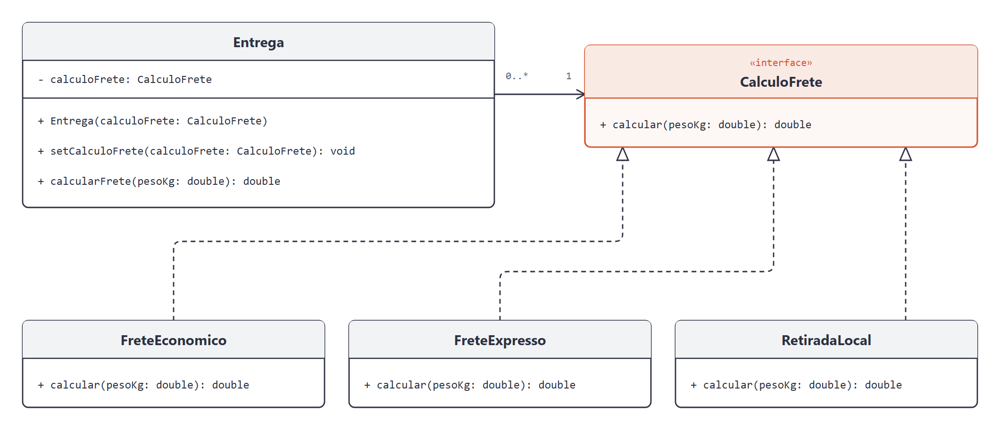

# DCC078 - Padrões de Projeto: Strategy

**Aluno:** Felipe Lazzarini Cunha

## Tema

O projeto representa o cálculo de frete de uma entrega. O Strategy permite escolher e trocar, em tempo de execução, entre frete econômico (R$ 10,00 mais R$ 2,00 por kg), expresso (R$ 20,00 mais R$ 4,00 por kg) e retirada no local (gratuita). As tarifas são fictícias, e o cálculo aceita pesos positivos e finitos, inclusive fracionados, sem integração com transportadoras.

## Diagrama de Classes UML



## Estrutura do Projeto

- `Entrega`: contexto que valida o peso e delega o cálculo à estratégia configurada.
- `CalculoFrete`: interface comum às estratégias de cálculo.
- `FreteEconomico`, `FreteExpresso` e `RetiradaLocal`: estratégias concretas que definem o valor do frete.
- `EntregaTest`: testes das estratégias, da troca em execução e das entradas inválidas.

## Testes

Com JDK 11 ou superior e Maven:

```bash
mvn test
```
